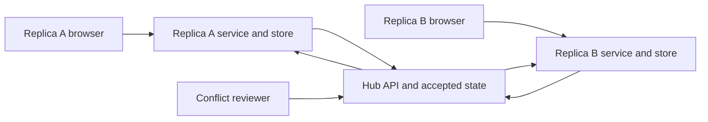

# Offline Database Synchronization Engine

Save an edit even when synchronization is stopped. When the connection returns, keep every unresolved proposal visible, explain conflicts, and bring both replicas to the same accepted state after review.

**Stage:** requirements and design baseline, 20 November 2026. This repository contains the complete documentation project. The runtime engine has not been implemented; acceptance and performance results are NOT RUN.

Start with the [documentation guide](docs/README.md), [product requirements](docs/requirements/product.md), [high-level design](docs/architecture/high-level-design.md), and [component designs](docs/design/README.md).

The project includes software/quality requirements, API and data contracts, browser journeys, transaction protocols, state machines, security, operations, failure tests, acceptance traceability and delivery milestones. The supplied requirements are preserved [unchanged](docs/source/Offline_Database_Synchronization_Requirements.md).

The hub owns accepted revisions and the global change sequence. A replica owns durable local intent. A successful local save is not a synchronization confirmation.

The proposed reference stack is Python with a locally served browser interface and SQLite on local disk, subject to the permitted mirror and desktop verification gate. Runtime communication stays on loopback. No cloud, Docker or real private data is required.

Licensed under [MIT](LICENSE).

## Examples and schemas

See [worked examples](examples/README.md), [JSON Schemas](schemas/README.md), and the [reference database schema](schemas/reference-schema.sql).
