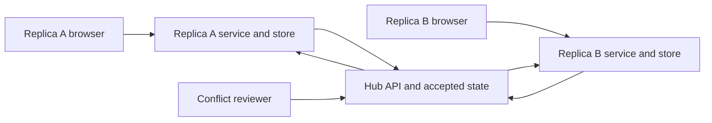
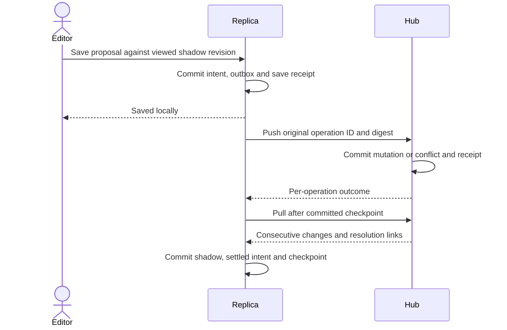

# High-level design

Save an edit even when synchronization is stopped. When the connection returns, keep every unresolved proposal visible, explain conflicts, and bring both replicas to the same accepted state after review.

The hub owns accepted revisions and the global change sequence. A replica owns durable local intent. A successful local save is not a synchronization confirmation.

## System context and deployment

All runtime services run as ordinary local processes. The browser uses same-origin HTTP, locally bundled assets and no telemetry/CDN. Canonical storage sits on supported local disk outside synchronized folders. Separate consumer/replica stores remain separate correctness boundaries.

## End-to-end sequence

## Component responsibilities

| Component | Responsibility |
| --- | --- |
| [Local editing and outbox](../design/local-editing.md) | Read the expected local view revision and reject an existing unresolved intent for this record. |
| [Hub acceptance and receipts](../design/hub-push.md) | Parse and bound the batch, then process each identified operation in its own transaction. |
| [Feed application and checkpoints](../design/pull-checkpoints.md) | Fetch after the last committed checkpoint, optionally bounded by captured high-water mark. |
| [Conflict review and tombstones](../design/conflict-resolution.md) | Load preserved base, proposal, detection-time hub value and current hub value separately. |
| [Consistent snapshot bootstrap](../design/snapshot-bootstrap.md) | Register a new replica identity and compatible source generation. |
| [Synchronizer ownership and recovery](../design/synchronizer.md) | Acquire a replica ownership lease and increment epoch atomically. |
| Control API | Parse requests, enforce roles/revisions/keys, dispatch domain services, return durable outcomes |
| Browser | Explain authoritative state and pending intent without advancing progress locally |
| Storage | Enforce uniqueness, foreign keys, immutable history and atomic mutation boundaries |
| Failure harness | Control exact stop points and query committed-state invariants |

Read the [data model](../contracts/data-model.md), [API contract](../contracts/api.md) and [transaction protocol](../design/transactions.md) together. No in-memory queue, local UI state or process lock is the sole correctness mechanism.
