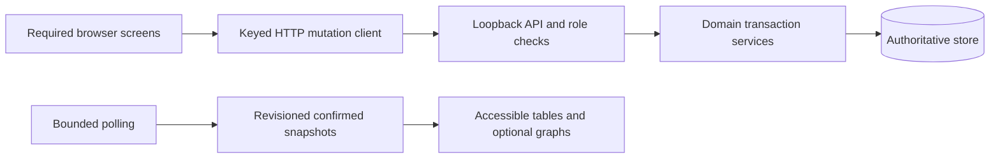

# Browser and control API design

Routes parse strict bounded input, validate a disposable fictional role, check Origin/Host, and call the domain service. They do not contain a second implementation of state transitions. Server-side role checks remain mandatory when a UI hides a control. No arbitrary handler/reducer code, URLs or paths enter the runtime.

Maintain loading, empty, disconnected, stale, forbidden, failed and pending-action states. Healthy visible views poll at a proposed one-second interval; back off disconnected reads without changing durable progress. Ignore older revisions arriving late. Persist mutation intent/key across an uncertain response and reuse it; revisions/decisions that conflict require explicit refresh and reconsideration.

Use escaped text, keyboard navigation, visible text statuses, focus-managed dialogs and complete table equivalents. The following screen contracts remain mandatory.

## Browser journeys

Provide separate labeled replica A/B workspaces; a hub record/change-feed view; outbox with local/accepted/conflicted/synchronized states; pause controls and connection indicators; conflict comparison/resolution; bootstrap/readiness diagnostics; and history/search.

Never show locally saved as globally synchronized. Mark accepted-awaiting-pull separately. Conflict UI displays base, proposed, detection-time hub state and current hub state; the reviewer confirms exactly the current revision/digest used in a decision. Restoring a deletion needs explicit wording. Preserve a stale review for comparison and require refresh before resubmission.

Browser refresh leaves intent and checkpoints unchanged. Two tabs editing one replica need optimistic guards. Keyboard operation and textual state labels are required. Bundle all assets locally, provide loading/empty/disconnected/error states, and avoid success before durable confirmation.

API list defaults are 50/maximum 200 unless a specialized read/feed contract specifies other bounds. Return stable error code, human-readable message, bounded field details and correlation ID. See the [complete API](../contracts/api.md) for operation-specific limits and range/conflict behavior.
