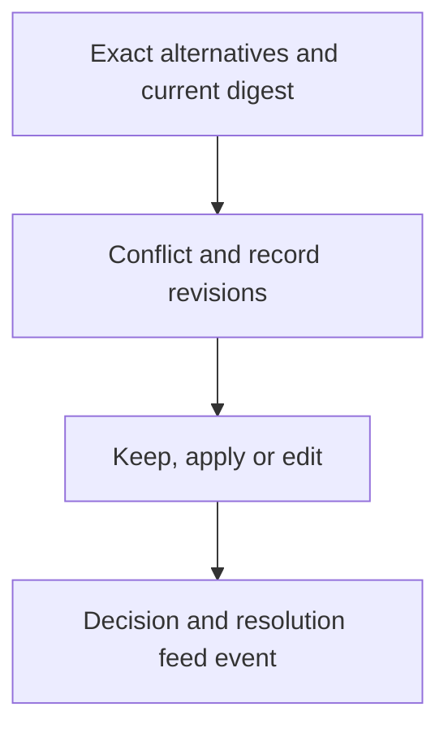

# Conflict review and tombstones

KEEP_CURRENT produces a notification without increasing the record revision. Restoring a tombstone requires explicit restore confirmation and creates a RESTORE mutation with a fresh revision. Preserve the original conflict receipt forever; it is not rewritten to accepted after review.

## Operation algorithm

1. Load preserved base, proposal, detection-time hub value and current hub value separately.
2. Require conflict revision, current record revision/digest, decision key and matching reviewer role.
3. Serialize KEEP_CURRENT, APPLY_PROPOSAL or APPLY_EDITED against exactly the viewed versions.
4. Commit decision, conflict resolution, optional record mutation, sequenced notification and receipt.

## Inputs outputs and ownership

The service receives a validated domain request, caller/process identity, target identity, expected revision or epoch where applicable, and stable operation key. Read authoritative mutable state inside the accepting transaction. Return the committed receipt/current bounded result, or a stable error without implying acceptance. Interfaces and fields are specified in the [API](../contracts/api.md) and [data model](../contracts/data-model.md).

## Atomicity and failure handling

Local save, hub acceptance, pull apply and resolution each have their own atomic boundary. No transaction spans hub and replica stores. Stable operation identities, receipts and linked feed events bridge those boundaries.

Use conditional source-state checks, uniqueness constraints and atomic audit/receipt writes. On contention roll back and retry the entire operation under bounded backoff, preserving the key. On uncertain response consult the receipt before repeating work. A stale revision/epoch requires refresh or fresh authority, never a silently rewritten request. Database unavailability stops new confirmations.

## Required behavior

## Conflicts and human resolution

Conflict states are OPEN and RESOLVED. Preserve original operation ID, proposed value or deletion, supplied base revision, available base value, authoritative revision/value at conflict creation and relevant history references. Later hub changes do not erase the original conflict. Show current authoritative state separately when reviewing an old conflict.

Supported decisions:

- KEEP_CURRENT: retain the hub record/tombstone and resolve the local proposal without changing record revision.
- APPLY_PROPOSAL: apply the proposed full record or deletion only against the current revision explicitly viewed by the reviewer.
- APPLY_EDITED: apply a schema-validated full record supplied by the reviewer against that viewed revision.

All decisions include expected conflict revision, expected current record revision, current-state digest, operation key and fictional reviewer. A concurrent hub mutation makes a stale decision fail with conflict; it must not silently retry against newer content. Resolution uses a fresh operation identity. Original conflicted-operation receipts remain immutable and continue to report their original conflict outcome.

For an applied resolution, new record revision/change event, decision, conflict settlement and receipt commit together. KEEP_CURRENT also emits a sequenced resolution-notification event, including authoritative state and original operation/conflict identity, so every replica can settle the pending intent without guessing. A resolution-only event does not increment the record revision; consumers distinguish it from a mutation.

When the target is tombstoned, restoring old data is not implicit. APPLY_PROPOSAL/APPLY_EDITED for a deleted target requires an explicit restore confirmation against the tombstone revision, creates a new revision and records a RESTORE mutation. Ordinary updates never restore deleted records.

Two reviewers deciding concurrently yield one accepted decision. A matching key replays the original result; a different conflicting decision receives a settled/stale response. Every alternative and final decision remains auditable.

## Deletion and identity lifetime

Deleted IDs remain reserved through tombstones. No garbage collection of tombstones, operation receipts or accepted history is allowed in the baseline. This costs storage but prevents a long-disconnected replica from resurrecting a forgotten deletion.

Explicit restore is a review operation with a current tombstone revision; generating a new ID creates a different record. Tests must distinguish delete/update, delete/delete, restore/stale-update and two-create collisions. Deleting a replica database is not a supported way to reset its identity: reseeding requires a new replica identity and a fresh bootstrap.

## Verification boundary

Exercise each applicable acceptance row linked in [traceability](../requirements/traceability.md). Test both serialized race orders, rollback before commit and response loss after commit. Assertions inspect committed state and immutable receipts; browser messages and process logs alone are insufficient evidence.
