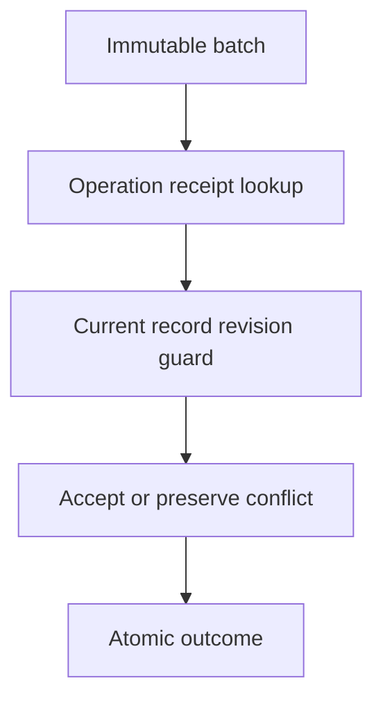

# Hub acceptance and receipts

A batch is deliberately not an all-or-nothing transaction. Stop after an explicit operation barrier to exercise partial acceptance, then resend the whole batch. Feed sequence allocation uses the same writer as record updates, so rollback exposes no hole.

## Operation algorithm

1. Parse and bound the batch, then process each identified operation in its own transaction.
2. Look up receipt by replica/operation ID before mutable revision checks; changed digest is a protocol conflict.
3. Serialize record revision, global feed sequence allocation and acceptance. Otherwise create preserved conflict alternatives without a record mutation.
4. Commit outcome, feed if accepted, audit and receipt; return one result per operation.

## Inputs outputs and ownership

The service receives a validated domain request, caller/process identity, target identity, expected revision or epoch where applicable, and stable operation key. Read authoritative mutable state inside the accepting transaction. Return the committed receipt/current bounded result, or a stable error without implying acceptance. Interfaces and fields are specified in the [API](../contracts/api.md) and [data model](../contracts/data-model.md).

## Atomicity and failure handling

Local save, hub acceptance, pull apply and resolution each have their own atomic boundary. No transaction spans hub and replica stores. Stable operation identities, receipts and linked feed events bridge those boundaries.

Use conditional source-state checks, uniqueness constraints and atomic audit/receipt writes. On contention roll back and retry the entire operation under bounded backoff, preserving the key. On uncertain response consult the receipt before repeating work. A stale revision/epoch requires refresh or fresh authority, never a silently rewritten request. Database unavailability stops new confirmations.

## Detailed behavior inherited from the source

## Push protocol and idempotency

| ID | Requirement |
| --- | --- |
| PUSH-01 | Send bounded batches of immutable outbox operations. Stable operation ID/content is preserved across transport retries. |
| PUSH-02 | Hub receipt lookup is scoped by replica/operation ID. Same digest returns the original outcome; changed content conflicts at the protocol level. |
| PUSH-03 | Each operation commits its own atomic outcome. A batch can have mixed results; response identifies every operation separately. |
| PUSH-04 | Accepted mutation, new record revision, hub change event and receipt commit together. |
| PUSH-05 | Conflicted operation, preserved alternatives and its immutable conflict receipt commit together without changing authoritative record data. |
| PUSH-06 | A partially processed batch can be resent in full; committed operations replay receipts and unprocessed operations are processed once. |
| PUSH-07 | Hub retries transaction conflicts as whole operations under bounded backoff. It never confirms an uncommitted write. |

Default batch limit is 100 operations/1 MiB encoded. Per-record payload maximum is 16 KiB. A pending operation transitions LOCAL_PENDING to SENDING, then ACCEPTED_AWAITING_PULL, CONFLICTED or REJECTED. SENDING is transport status, not global authority; after restart, an uncertain SENDING operation is resent under the same ID.

Push responses do not advance the replica's pull checkpoint and do not overwrite its shadow. Accepted intent remains visibly pending until the authoritative change feed applies the accepted event or an explicitly linked later resolution. That prevents a push response followed by an older pull page from moving the shadow backward.

A terminal hub rejection proves that operation made no authoritative mutation. Preserve its proposal and receipt as history, remove its pending overlay and release its local edit lock; a corrected proposal uses a fresh operation ID and newly viewed base revision. A transport error or uncertain response is not a terminal rejection and must never release that lock. Invalid operation contracts return a durable per-operation rejection receipt when identity and digest can be safely parsed; malformed envelopes are rejected before processing.

## Hub revision rules

The hub serializes updates to each record and assigns an increasing global sequence to accepted mutations. Each record revision starts at 1 and increases by 1 on every accepted update or deletion. Revision checks and mutation are one transaction.

Allocate the next feed sequence in the same transaction as a mutation or resolution notification. Rollback does not expose a sequence gap. The feed is contiguous from its initial sequence, including resolution-only notifications, and checkpoints identify the last fully applied sequence rather than a count of record mutations.

| Operation | Required precondition | Outcome |
| --- | --- | --- |
| Create | ID never existed and baseRevision=0 | Create revision 1 and accepted event. |
| Update | Record exists, is not deleted and baseRevision equals current revision | Replace allowed fields; increment revision and append event. |
| Delete | Record exists, is not deleted and baseRevision equals current revision | Persist tombstone, increment revision and append event. |
| Stale update/delete | Base differs, target deleted or target absent | Persist explicit conflict; no silent overwrite or resurrection. |
| Duplicate operation | Same ID and digest already has receipt | Return original receipt without new revision/sequence. |

Record mutation sequences are committed in the hub's durable order, not client timestamps. Concurrent disconnected edits to the same base produce one accepted result and one conflict according to transaction order. Disjoint field edits still conflict at record level; automatic merge is intentionally deferred.

## Failure and transaction boundaries

| Stop point | Required recovery |
| --- | --- |
| Before local edit/outbox commit | Neither intent nor outbox is visible. |
| After local commit before browser response | Same client key returns the original saved intent. |
| After hub accepts operation before response | Same operation ID returns original revision/sequence. |
| Halfway through push batch | Resend entire batch; previously accepted items replay outcomes. |
| During local pull application | Rollback leaves old shadow and checkpoint; retry same page. |
| After pull commit before response | Duplicate page is recognized and does not reapply effects. |
| Before resolution commit | Conflict remains open with unchanged authoritative state. |
| After resolution commit before response | Keyed replay returns original decision and sequence. |

No transaction is assumed to span hub and replica databases. Correctness comes from stable IDs, immutable receipts and atomic local boundaries. Document isolation, lock order, conflict retries and linearization. Never hold a database write lock during network I/O or human review.

## Verification boundary

Exercise each applicable acceptance row linked in [traceability](../requirements/traceability.md). Test both serialized race orders, rollback before commit and response loss after commit. Assertions inspect committed state and immutable receipts; browser messages and process logs alone are insufficient evidence.
