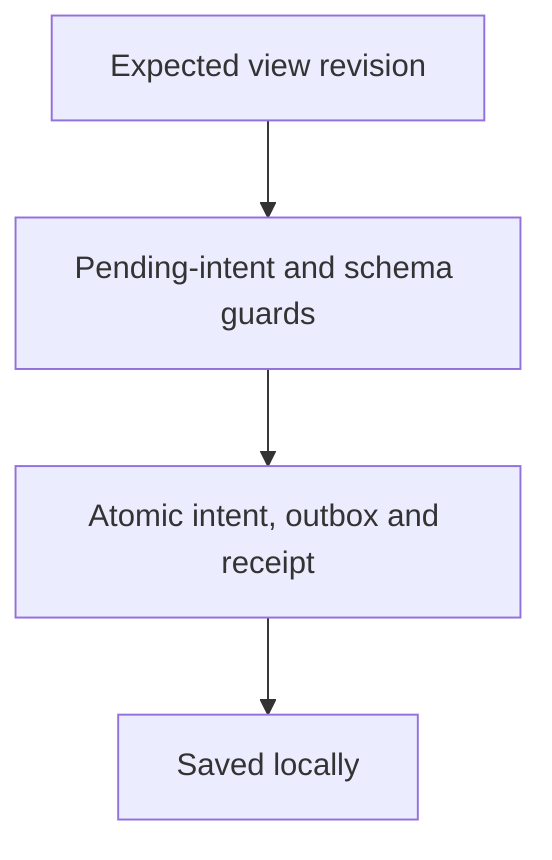

# Local editing and outbox

Use a unique partial index on record ID for unresolved intents. The local view revision must change when either its shadow or its overlay changes, so a stale tab cannot submit against a different visible base. A terminal hub rejection releases the lock but retains proposal/history; a timeout never does.

## Operation algorithm

1. Read the expected local view revision and reject an existing unresolved intent for this record.
2. Capture the current shadow revision without rewriting it later; validate create/update/delete and canonical content.
3. Commit the immutable operation, pending overlay, view revision, audit and client receipt together.
4. On an uncertain browser response replay the client key. Block only this record; other records stay editable.

## Inputs outputs and ownership

The service receives a validated domain request, caller/process identity, target identity, expected revision or epoch where applicable, and stable operation key. Read authoritative mutable state inside the accepting transaction. Return the committed receipt/current bounded result, or a stable error without implying acceptance. Interfaces and fields are specified in the [API](../contracts/api.md) and [data model](../contracts/data-model.md).

## Atomicity and failure handling

Local save, hub acceptance, pull apply and resolution each have their own atomic boundary. No transaction spans hub and replica stores. Stable operation identities, receipts and linked feed events bridge those boundaries.

Use conditional source-state checks, uniqueness constraints and atomic audit/receipt writes. On contention roll back and retry the entire operation under bounded backoff, preserving the key. On uncertain response consult the receipt before repeating work. A stale revision/epoch requires refresh or fresh authority, never a silently rewritten request. Database unavailability stops new confirmations.

## Detailed behavior inherited from the source

## Core records and semantics

| Term | Meaning |
| --- | --- |
| Shadow record | Last accepted hub state applied at a replica. |
| Local intent | Proposed create/update/delete based on a specific shadow revision. |
| Outbox operation | Immutable submitted intent with replica instance, operation ID, base revision and digest. |
| Hub receipt | Immutable accepted/conflicted/rejected outcome for an operation ID and content. |
| Hub change sequence | Monotonic ordering of accepted record mutations across the hub. |
| Pull checkpoint | Highest contiguous hub change sequence applied locally. |
| Conflict | Preserved incompatible proposal, base revision and authoritative state requiring an explicit decision. |
| Tombstone | Versioned deletion retained to prevent stale updates from silently recreating a record. |

At most one unresolved local intent per record per replica is allowed in the first release. After saving it, additional edits to that record are blocked until synchronization or conflict resolution settles it. Editing other records remains possible. This avoids hidden local dependency chains; supporting multiple queued edits to one record is later work.

The replica stores shadow data separately from pending intent. Incoming remote changes may advance the shadow but cannot silently overwrite or discard unresolved local intent. The browser clearly distinguishes those layers.

## Local editing requirements

| ID | Requirement |
| --- | --- |
| LOC-01 | Create/update/delete validates a bounded record schema and checks expected local view revision. |
| LOC-02 | Saving an intent and inserting its outbox operation commit in the same local transaction before success is shown. |
| LOC-03 | Each operation has a stable unique ID, replica identity, base hub revision, kind, canonical proposed value/digest and creation time. |
| LOC-04 | Initial create uses base revision 0 and succeeds at the hub only if that ID has never existed. |
| LOC-05 | Update/delete captures the last shadow revision seen by the editor. A stale browser tab cannot quietly change that base. |
| LOC-06 | One unresolved operation locks that record for further local edits; show the reason and its pending state. |
| LOC-07 | Browser reload or replica restart preserves intent, operation ID and the distinction from accepted shadow data. |
| LOC-08 | No discard/cancel of a submitted operation is supported initially. Local deletion of outbox rows is not a cancellation protocol. |

Different replicas creating the same record ID conflict rather than silently merging. UI-generated IDs should normally avoid that collision, but the protocol and tests must still handle it. Input content is never executed as SQL, paths or scripts.

## Verification boundary

Exercise each applicable acceptance row linked in [traceability](../requirements/traceability.md). Test both serialized race orders, rollback before commit and response loss after commit. Assertions inspect committed state and immutable receipts; browser messages and process logs alone are insufficient evidence.
