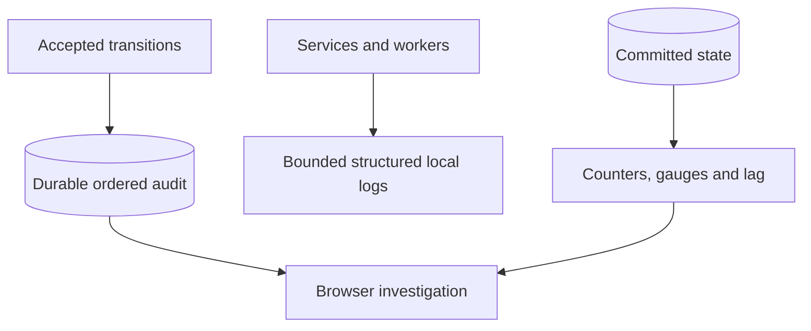

# Observability and diagnosis

Every diagnostic includes correlation ID and applicable stream/queue/replica, operation, record/event/entry and process identity. Audit is transactional evidence; process logs and metrics help explain behavior. Redact tokens and never log arbitrary full payloads by default. Heartbeats need no individual audit event.

Liveness means the process responds. Readiness requires supported schema, storage access, configuration and integrity checks. An unavailable store returns explicit not-ready and stops confirmation. Show the exact blocking reason, retained bounds/lag or pending authority so an operator can choose a safe action.

## Observability backup and resource limits

Metrics include unresolved outbox count/age, checkpoint lag, push/pull throughput, duplicate operations, open conflicts, stale resolution rejections, retry/backoff count and storage size. Audit local intent save, hub acceptance/conflict, decisions, snapshot install and pause/resume. Include replica, operation, record, conflict and sequence IDs without leaking tokens.

Keep schema migrations versioned and explicit. Refuse incompatible/newer schema; never auto-reset a database. For a complete demo restore, stop hub/replica services and take coordinated consistent snapshots of all three stores, identities, receipts and checkpoints. Restore into isolated directories with fresh synchronizer process instances. A restored replica from a different hub generation must be rejected rather than silently synced. Do not overwrite evidence when regenerating templates.

No tombstone/feed receipt garbage collection means storage grows with accepted history. Enforce configurable caps and return backpressure without deleting unresolved intent. Initial targets: 10,000 current records, 100,000 accepted history entries, two replicas, 100-operation/1 MiB batches, 16 KiB records, p95 local edit under 500 ms, 1,000 nonconflicting operations synchronized to both replicas within 60 seconds after resume on a healthy desktop, UI state within 3 seconds and total services/stores under 2 GiB RAM excluding browser/build. Measure rather than promise these targets. Conflicts requiring human decisions are excluded from automatic convergence latency.

Keep metrics labels bounded; individual IDs belong in drill-down views rather than unlimited time-series labels. Preserve actual measurements and failures separately from report templates.
