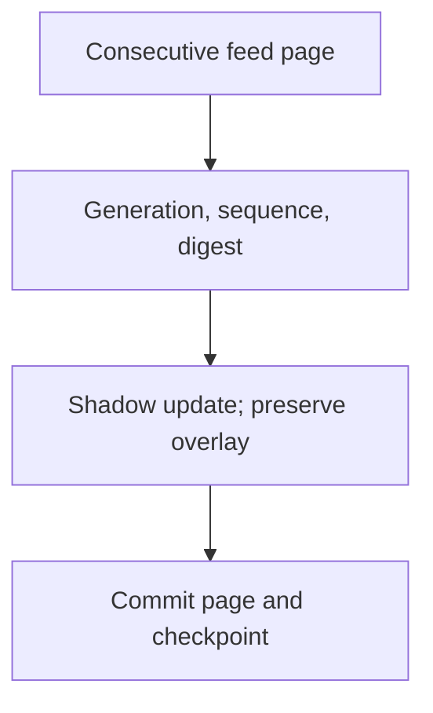

# Feed application and checkpoints

An old duplicate page entirely at/below checkpoint is a no-op. A gap or an inconsistent overlapping page is rejected, never skipped. KEEP_CURRENT may carry an unchanged record revision: its resolution notification advances the feed sequence without fabricating a mutation.

## Operation algorithm

1. Fetch after the last committed checkpoint, optionally bounded by captured high-water mark.
2. Verify source generation, consecutive sequence, payload digest and mutation-versus-notification kind.
3. Apply monotonic shadow changes while preserving unresolved local overlays.
4. Settle only explicitly linked own intent; advance checkpoint with all page writes in one local transaction.

## Inputs outputs and ownership

The service receives a validated domain request, caller/process identity, target identity, expected revision or epoch where applicable, and stable operation key. Read authoritative mutable state inside the accepting transaction. Return the committed receipt/current bounded result, or a stable error without implying acceptance. Interfaces and fields are specified in the [API](../contracts/api.md) and [data model](../contracts/data-model.md).

## Atomicity and failure handling

Local save, hub acceptance, pull apply and resolution each have their own atomic boundary. No transaction spans hub and replica stores. Stable operation identities, receipts and linked feed events bridge those boundaries.

Use conditional source-state checks, uniqueness constraints and atomic audit/receipt writes. On contention roll back and retry the entire operation under bounded backoff, preserving the key. On uncertain response consult the receipt before repeating work. A stale revision/epoch requires refresh or fresh authority, never a silently rewritten request. Database unavailability stops new confirmations.

## Required behavior

## Accepted change feed and pull

The hub exposes accepted mutations in sequence order with immutable operation identity, record ID, revision, complete post-change state/tombstone and optional resolution linkage. It also exposes low/high sequence bounds. All historical accepted changes are retained in the first release; feed compaction is not supported.

Pull uses `afterSequence`, maximum items/bytes and optional captured `throughSequence` for bounded catch-up. A page returns consecutive feed entries, next checkpoint and high-water mark from one consistent snapshot. Empty pages preserve progress. Duplicate pages are safe; missing or out-of-order pages are rejected rather than skipped.

Applying a pull batch and advancing the local checkpoint commit in one replica transaction. Apply accepted revisions monotonically and validate record progression; unexpected gaps fail readiness for investigation. Do not advance the checkpoint before record writes. A repeated page at/below the checkpoint changes nothing. The hub does not treat a client pull request as proof the replica applied it.

When a feed entry links to the replica's own accepted operation, clear its intent and mark it SYNCHRONIZED in the same transaction as shadow update/checkpoint. When another writer changed that record, preserve unresolved local intent. Conflict resolution events carry enough linkage to settle the corresponding conflicted intent. A replica with no pending/conflicted intents and caught up through a shared high-water mark must have the same canonical authoritative digest as the hub.

## Failure and transaction boundaries

| Stop point | Required recovery |
| --- | --- |
| Before local edit/outbox commit | Neither intent nor outbox is visible. |
| After local commit before browser response | Same client key returns the original saved intent. |
| After hub accepts operation before response | Same operation ID returns original revision/sequence. |
| Halfway through push batch | Resend entire batch; previously accepted items replay outcomes. |
| During local pull application | Rollback leaves old shadow and checkpoint; retry same page. |
| After pull commit before response | Duplicate page is recognized and does not reapply effects. |
| Before resolution commit | Conflict remains open with unchanged authoritative state. |
| After resolution commit before response | Keyed replay returns original decision and sequence. |

No transaction is assumed to span hub and replica databases. Correctness comes from stable IDs, immutable receipts and atomic local boundaries. Document isolation, lock order, conflict retries and linearization. Never hold a database write lock during network I/O or human review.

## Verification boundary

Exercise each applicable acceptance row linked in [traceability](../requirements/traceability.md). Test both serialized race orders, rollback before commit and response loss after commit. Assertions inspect committed state and immutable receipts; browser messages and process logs alone are insufficient evidence.
