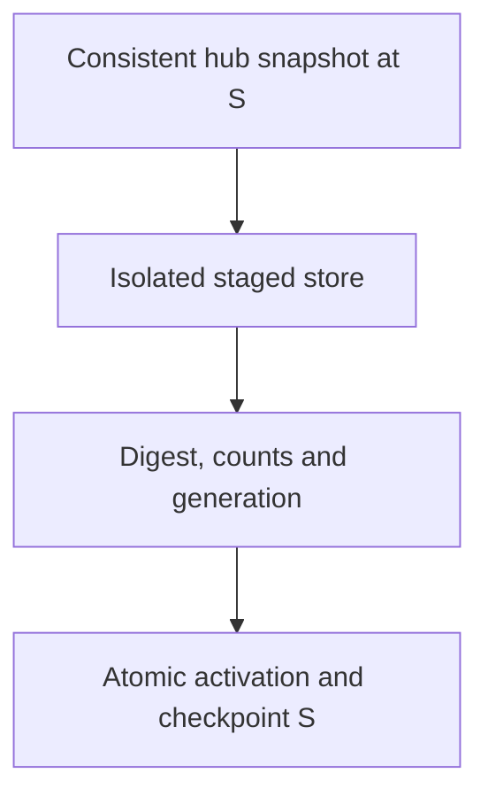

# Consistent snapshot bootstrap

Never page live mutable rows without a snapshot identity. Refuse installation over unresolved intent. Interrupted staging can be discarded; active replica state remains intact. A replaced hub generation is an explicit incompatibility, not permission to reset identity.

## Operation algorithm

1. Register a new replica identity and compatible source generation.
2. Materialize a stable snapshot at sequence S inside one consistent view; include tombstones and manifest.
3. Verify counts, schema and canonical digest in a staged store.
4. Atomically activate the complete store and checkpoint S; pull strictly after S.

## Inputs outputs and ownership

The service receives a validated domain request, caller/process identity, target identity, expected revision or epoch where applicable, and stable operation key. Read authoritative mutable state inside the accepting transaction. Return the committed receipt/current bounded result, or a stable error without implying acceptance. Interfaces and fields are specified in the [API](../contracts/api.md) and [data model](../contracts/data-model.md).

## Atomicity and failure handling

Local save, hub acceptance, pull apply and resolution each have their own atomic boundary. No transaction spans hub and replica stores. Stable operation identities, receipts and linked feed events bridge those boundaries.

Use conditional source-state checks, uniqueness constraints and atomic audit/receipt writes. On contention roll back and retry the entire operation under bounded backoff, preserving the key. On uncertain response consult the receipt before repeating work. A stale revision/epoch requires refresh or fresh authority, never a silently rewritten request. Database unavailability stops new confirmations.

## Detailed behavior inherited from the source

## Bootstrap and snapshot contract

Register a fresh replica identity and obtain a consistent hub snapshot at sequence S. The snapshot includes all authoritative records, tombstones, schema version, manifest/counts and canonical digest. The hub must preserve a consistent snapshot while exporting; naive pagination over changing live rows is insufficient.

Verify and import the snapshot into a new local store atomically or through an isolated staged database plus atomic activation. Set pull checkpoint to S only with the fully imported state. Pull accepted events after S to catch up. Snapshot installation cannot overwrite a replica with unresolved intent; refuse that operation and preserve its existing store.

A corrupt, partial, incompatible or mixed-version snapshot is rejected without replacing the current state. First release retains the whole change feed, so no expired-cursor protocol is needed. Limits and storage pressure must still be reported.

## Verification boundary

Exercise each applicable acceptance row linked in [traceability](../requirements/traceability.md). Test both serialized race orders, rollback before commit and response loss after commit. Assertions inspect committed state and immutable receipts; browser messages and process logs alone are insufficient evidence.
