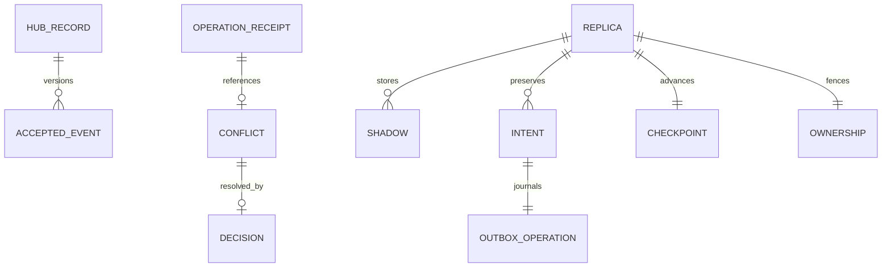

# Storage component and integrity design

The storage layer implements the atomic boundaries described by the domain services. Current state, authority, audit and receipts agree at commit. The entity relationships below are logical; cross-store associations are protocol checks rather than cross-database foreign keys.

## Keys constraints and indexes

Hub: unique record ID, unique global feed sequence, unique replica/operation receipt, one accepted decision per conflict, and immutable detection alternatives. Replica: unique operation ID, partial unique unresolved-intent record ID, source-generation checkpoint singleton, and ownership epoch singleton. Index outbox(state,createdAt,operationId), feed(sequence), conflicts(state,id) and record IDs/revisions.

For records, distinguish mutation revision from resolution-notification sequence. CREATE reserves never-used identity; tombstones retain identity forever. Store local view revision separately from hub shadow revision. Do not enforce a foreign key across stores; validate replica registry and generation in the protocol.

Snapshot manifest fields are snapshotId, sourceGeneration, schemaVersion, throughSequence, recordCount, tombstoneCount, canonicalDigest and formatVersion. Each exported page is tied to that stable snapshot, not a live list cursor.

## Repository interfaces

Expose short transaction-scoped repository methods for receipt lookup, aggregate load, conditional transition, ordered audit allocation and outcome insert. Do not expose arbitrary table mutation to handlers or browser routes. API/coordinator code shares one domain transaction library. Return typed conflict/unavailable errors and preserve the original operation key on retry.

## Migration and durability rules

Use explicit supported schema versions, migration checksums, NOT NULL identities, foreign keys within each store, enumerated states and positive bounds. Immutable payload/receipt/history fields and terminal outcomes require service guards plus migration-level triggers. A nullable CHECK is insufficient for a mandatory identity. Do not delete records needed for receipt replay or lineage explanation.

Store JSON in the declared canonical format and bounded bytes separately from audit summaries. Persist database-evaluated UTC times and integer counters. Use a connection per bounded operation with foreign keys and durability settings verified. Avoid long read snapshots that retain excessive WAL pages. Unknown newer schemas fail readiness.

The complete entity dictionary is in [data-model contract](../contracts/data-model.md). Crash, unique-key, rollback and concurrent-writer tests remain implementation work; a documented schema is not evidence of those guarantees.
