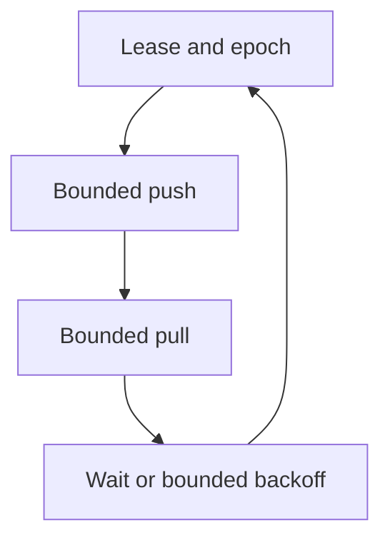

# Synchronizer ownership and recovery

Use database time for the 15-second ownership lease and 5-second heartbeat. An expired owner cannot revive itself. External responses may arrive after another owner takes over: receipt content can be read, but local state mutation still requires current epoch.

## Operation algorithm

1. Acquire a replica ownership lease and increment epoch atomically.
2. Respect independently persisted push/pull pause controls before each transfer.
3. Do network I/O outside local write transactions; recheck ownership epoch before applying results.
4. After restart resend uncertain operations under original IDs and resume from committed checkpoint.

## Inputs outputs and ownership

The service receives a validated domain request, caller/process identity, target identity, expected revision or epoch where applicable, and stable operation key. Read authoritative mutable state inside the accepting transaction. Return the committed receipt/current bounded result, or a stable error without implying acceptance. Interfaces and fields are specified in the [API](../contracts/api.md) and [data model](../contracts/data-model.md).

## Atomicity and failure handling

Local save, hub acceptance, pull apply and resolution each have their own atomic boundary. No transaction spans hub and replica stores. Stable operation identities, receipts and linked feed events bridge those boundaries.

Use conditional source-state checks, uniqueness constraints and atomic audit/receipt writes. On contention roll back and retry the entire operation under bounded backoff, preserving the key. On uncertain response consult the receipt before repeating work. A stale revision/epoch requires refresh or fresh authority, never a silently rewritten request. Database unavailability stops new confirmations.

## Required behavior

## Synchronizer lifecycle and recovery

Per replica, the synchronizer is STOPPED, IDLE, PUSHING, PULLING, BACKOFF, PAUSED or ERROR. Durable records, not this process state, determine actual progress. The operator can pause push, pull or both to demonstrate disconnection; local editing remains available where record-level pending constraints allow it.

Allow one authorized synchronization process per replica using a lease/epoch or an equivalent tested local ownership mechanism. A stale synchronizer cannot regress checkpoints or alter operation outcomes. Default ownership lease is 15 seconds with 5-second heartbeat. Each replica's database serializes edit, pull-apply and local outcome transitions.

On restart recover pending/uncertain outbox operations with their original IDs, read the last committed checkpoint and resume bounded batches. Database/API uncertainty triggers bounded backoff without fabricated acceptance. Graceful shutdown stops new transfers and completes bounded local transactions. Hard stop relies on durable receipts and atomic local apply.

## Failure and transaction boundaries

| Stop point | Required recovery |
| --- | --- |
| Before local edit/outbox commit | Neither intent nor outbox is visible. |
| After local commit before browser response | Same client key returns the original saved intent. |
| After hub accepts operation before response | Same operation ID returns original revision/sequence. |
| Halfway through push batch | Resend entire batch; previously accepted items replay outcomes. |
| During local pull application | Rollback leaves old shadow and checkpoint; retry same page. |
| After pull commit before response | Duplicate page is recognized and does not reapply effects. |
| Before resolution commit | Conflict remains open with unchanged authoritative state. |
| After resolution commit before response | Keyed replay returns original decision and sequence. |

No transaction is assumed to span hub and replica databases. Correctness comes from stable IDs, immutable receipts and atomic local boundaries. Document isolation, lock order, conflict retries and linearization. Never hold a database write lock during network I/O or human review.

## Verification boundary

Exercise each applicable acceptance row linked in [traceability](../requirements/traceability.md). Test both serialized race orders, rollback before commit and response loss after commit. Assertions inspect committed state and immutable receipts; browser messages and process logs alone are insufficient evidence.
