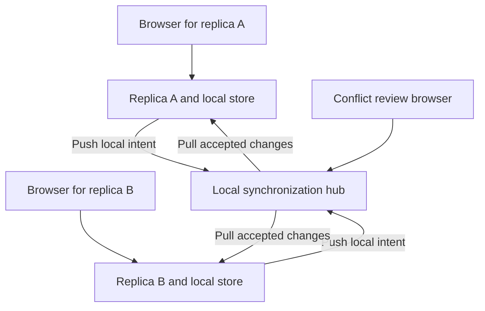

# Product requirements and scope

Save an edit even when synchronization is stopped. When the connection returns, keep every unresolved proposal visible, explain conflicts, and bring both replicas to the same accepted state after review.

## Purpose and outcome

Build a synchronization engine for two independently writable local replicas and one local coordination hub. Each replica accepts synthetic record edits while synchronization is paused. On reconnection, changes are exchanged, duplicates are recognized, conflicting edits are preserved for explicit review, and resolved replicas converge.

A browser interface shows both replicas, their pending operations, the hub's accepted history and the exact alternatives in each conflict. Success is demonstrated through deterministic scenarios, interrupted batches, process restarts and equality of canonical final data after all pending decisions are resolved.

This is a single-machine demonstration of disconnected editing and synchronization, not a production mobile platform, peer-to-peer consensus protocol or arbitrary-database replication product. All requirements and targets are proposed. Programme approval, project origin and participant authorship remain independent decisions; this document does not certify them.

## People and motivating use case

| User | Need |
| --- | --- |
| Local editor | Save an edit without waiting for a synchronizer to be available. |
| Operator | Understand which changes are local, accepted, conflicted or fully synchronized. |
| Conflict reviewer | Compare base, local and authoritative values and choose the intended result without losing evidence. |
| Developer | Verify retries and crashes never apply an operation twice or silently overwrite a conflicting change. |

Use a fictional equipment catalogue with stable record IDs, labels, categories and bounded integer quantities. Two browser workspaces edit separate replica services. Data is generated, never a real inventory, personal record, customer database or employer export.

## Environment and scope

Run a hub service and two replica services as ordinary local processes, each with its own local transactional database. Each service serves locally bundled browser assets. Synchronization uses loopback APIs. Pausing transport between these processes simulates disconnected replicas; no internet outage or second physical device is required.

No cloud, Docker, GPU, sound, Windows-specific component, account sign-in, real tokens, AI infrastructure or external service is required. Select supported language, framework and one database technology only after verifying the supplied mirror. Native SQLite session extensions, CRDT libraries and specialist replication packages are not prerequisites; an application-level transactional journal is sufficient.

Required scope: explicit schema, local durable edits/outbox, hub operation receipts, optimistic revisions, ordered accepted-change feed, checkpoints, interruption recovery, tombstones, conflict review, snapshot bootstrap and browser diagnostics.

Deferred: arbitrary schema discovery, binary attachments, peer-to-peer multi-master consensus, automatic field-level merge, CRDTs, schema evolution of active data, full SQL/WAL replication, tombstone garbage collection, cloud synchronization, real multi-user authentication and host file synchronization.

## Topology and authority

The hub is the authority for accepted global record revisions and change sequence. Replica edits are durable local intent until accepted by the hub. Both replicas can write while disconnected, but they cannot independently declare their state globally authoritative. This central hub boundary makes conflict behaviour explicit and testable.

A lost hub response cannot be distinguished from a lost request using timing alone. Stable operation IDs and receipts resolve that ambiguity. A local edit confirmation means its local intent is durable, not that another replica has received it.

## Data and canonical fixture

The initial record contract is `{recordId,label,category,quantity}`. IDs are opaque generated strings; labels/categories are bounded plain text; quantity is an integer in a declared finite range. Hub state adds revision, deleted flag and accepted-change sequence. Deletions retain the record ID, revision and deletion event as a tombstone.

Generate 1,000 initial records from a fixed seed and bootstrap both replicas from one hub snapshot. A scripted edit fixture exercises distinct-record changes, same-record conflicts, deletes, duplicate submissions and stale resolutions. Include a small deterministic conflict fixture whose prescribed decisions yield a known canonical final hash, plus a larger stress fixture with 10,000 operations and checked invariants.

The canonical final digest covers sorted IDs, revisions, tombstones and canonical record values. Local pending overlays and transport timestamps are not part of that digest. Physical database byte equality is not required. Compute real fixture hashes during implementation and retain the generator/reducer version.

## Core records and semantics

| Term | Meaning |
| --- | --- |
| Shadow record | Last accepted hub state applied at a replica. |
| Local intent | Proposed create/update/delete based on a specific shadow revision. |
| Outbox operation | Immutable submitted intent with replica instance, operation ID, base revision and digest. |
| Hub receipt | Immutable accepted/conflicted/rejected outcome for an operation ID and content. |
| Hub change sequence | Monotonic ordering of accepted record mutations across the hub. |
| Pull checkpoint | Highest contiguous hub change sequence applied locally. |
| Conflict | Preserved incompatible proposal, base revision and authoritative state requiring an explicit decision. |
| Tombstone | Versioned deletion retained to prevent stale updates from silently recreating a record. |

At most one unresolved local intent per record per replica is allowed in the first release. After saving it, additional edits to that record are blocked until synchronization or conflict resolution settles it. Editing other records remains possible. This avoids hidden local dependency chains; supporting multiple queued edits to one record is later work.

The replica stores shadow data separately from pending intent. Incoming remote changes may advance the shadow but cannot silently overwrite or discard unresolved local intent. The browser clearly distinguishes those layers.
