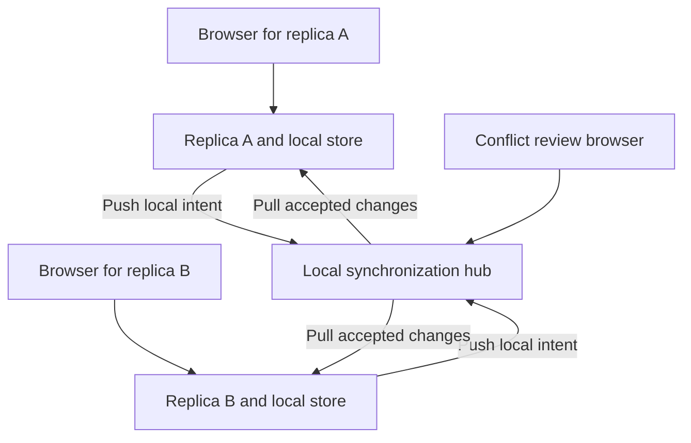

# Offline Database Synchronization Engine Requirements

Version 0.1 | 20 November 2026 | Language agnostic | Proposed first release

## 1 Purpose and outcome

Build a synchronization engine for two independently writable local replicas and one local coordination hub. Each replica accepts synthetic record edits while synchronization is paused. On reconnection, changes are exchanged, duplicates are recognized, conflicting edits are preserved for explicit review, and resolved replicas converge.

A browser interface shows both replicas, their pending operations, the hub's accepted history and the exact alternatives in each conflict. Success is demonstrated through deterministic scenarios, interrupted batches, process restarts and equality of canonical final data after all pending decisions are resolved.

This is a single-machine demonstration of disconnected editing and synchronization, not a production mobile platform, peer-to-peer consensus protocol or arbitrary-database replication product. All requirements and targets are proposed. Programme approval, project origin and participant authorship remain independent decisions; this document does not certify them.

## 2 People and motivating use case

| User | Need |
| --- | --- |
| Local editor | Save an edit without waiting for a synchronizer to be available. |
| Operator | Understand which changes are local, accepted, conflicted or fully synchronized. |
| Conflict reviewer | Compare base, local and authoritative values and choose the intended result without losing evidence. |
| Developer | Verify retries and crashes never apply an operation twice or silently overwrite a conflicting change. |

Use a fictional equipment catalogue with stable record IDs, labels, categories and bounded integer quantities. Two browser workspaces edit separate replica services. Data is generated, never a real inventory, personal record, customer database or employer export.

## 3 Environment and scope

Run a hub service and two replica services as ordinary local processes, each with its own local transactional database. Each service serves locally bundled browser assets. Synchronization uses loopback APIs. Pausing transport between these processes simulates disconnected replicas; no internet outage or second physical device is required.

No cloud, Docker, GPU, sound, Windows-specific component, account sign-in, real tokens, AI infrastructure or external service is required. Select supported language, framework and one database technology only after verifying the supplied mirror. Native SQLite session extensions, CRDT libraries and specialist replication packages are not prerequisites; an application-level transactional journal is sufficient.

Required scope: explicit schema, local durable edits/outbox, hub operation receipts, optimistic revisions, ordered accepted-change feed, checkpoints, interruption recovery, tombstones, conflict review, snapshot bootstrap and browser diagnostics.

Deferred: arbitrary schema discovery, binary attachments, peer-to-peer multi-master consensus, automatic field-level merge, CRDTs, schema evolution of active data, full SQL/WAL replication, tombstone garbage collection, cloud synchronization, real multi-user authentication and host file synchronization.

## 4 Topology and authority

The hub is the authority for accepted global record revisions and change sequence. Replica edits are durable local intent until accepted by the hub. Both replicas can write while disconnected, but they cannot independently declare their state globally authoritative. This central hub boundary makes conflict behaviour explicit and testable.

A lost hub response cannot be distinguished from a lost request using timing alone. Stable operation IDs and receipts resolve that ambiguity. A local edit confirmation means its local intent is durable, not that another replica has received it.

## 5 Data and canonical fixture

The initial record contract is `{recordId,label,category,quantity}`. IDs are opaque generated strings; labels/categories are bounded plain text; quantity is an integer in a declared finite range. Hub state adds revision, deleted flag and accepted-change sequence. Deletions retain the record ID, revision and deletion event as a tombstone.

Generate 1,000 initial records from a fixed seed and bootstrap both replicas from one hub snapshot. A scripted edit fixture exercises distinct-record changes, same-record conflicts, deletes, duplicate submissions and stale resolutions. Include a small deterministic conflict fixture whose prescribed decisions yield a known canonical final hash, plus a larger stress fixture with 10,000 operations and checked invariants.

The canonical final digest covers sorted IDs, revisions, tombstones and canonical record values. Local pending overlays and transport timestamps are not part of that digest. Physical database byte equality is not required. Compute real fixture hashes during implementation and retain the generator/reducer version.

## 6 Core records and semantics

| Term | Meaning |
| --- | --- |
| Shadow record | Last accepted hub state applied at a replica. |
| Local intent | Proposed create/update/delete based on a specific shadow revision. |
| Outbox operation | Immutable submitted intent with replica instance, operation ID, base revision and digest. |
| Hub receipt | Immutable accepted/conflicted/rejected outcome for an operation ID and content. |
| Hub change sequence | Monotonic ordering of accepted record mutations across the hub. |
| Pull checkpoint | Highest contiguous hub change sequence applied locally. |
| Conflict | Preserved incompatible proposal, base revision and authoritative state requiring an explicit decision. |
| Tombstone | Versioned deletion retained to prevent stale updates from silently recreating a record. |

At most one unresolved local intent per record per replica is allowed in the first release. After saving it, additional edits to that record are blocked until synchronization or conflict resolution settles it. Editing other records remains possible. This avoids hidden local dependency chains; supporting multiple queued edits to one record is later work.

The replica stores shadow data separately from pending intent. Incoming remote changes may advance the shadow but cannot silently overwrite or discard unresolved local intent. The browser clearly distinguishes those layers.

## 7 Local editing requirements

| ID | Requirement |
| --- | --- |
| LOC-01 | Create/update/delete validates a bounded record schema and checks expected local view revision. |
| LOC-02 | Saving an intent and inserting its outbox operation commit in the same local transaction before success is shown. |
| LOC-03 | Each operation has a stable unique ID, replica identity, base hub revision, kind, canonical proposed value/digest and creation time. |
| LOC-04 | Initial create uses base revision 0 and succeeds at the hub only if that ID has never existed. |
| LOC-05 | Update/delete captures the last shadow revision seen by the editor. A stale browser tab cannot quietly change that base. |
| LOC-06 | One unresolved operation locks that record for further local edits; show the reason and its pending state. |
| LOC-07 | Browser reload or replica restart preserves intent, operation ID and the distinction from accepted shadow data. |
| LOC-08 | No discard/cancel of a submitted operation is supported initially. Local deletion of outbox rows is not a cancellation protocol. |

Different replicas creating the same record ID conflict rather than silently merging. UI-generated IDs should normally avoid that collision, but the protocol and tests must still handle it. Input content is never executed as SQL, paths or scripts.

## 8 Push protocol and idempotency

| ID | Requirement |
| --- | --- |
| PUSH-01 | Send bounded batches of immutable outbox operations. Stable operation ID/content is preserved across transport retries. |
| PUSH-02 | Hub receipt lookup is scoped by replica/operation ID. Same digest returns the original outcome; changed content conflicts at the protocol level. |
| PUSH-03 | Each operation commits its own atomic outcome. A batch can have mixed results; response identifies every operation separately. |
| PUSH-04 | Accepted mutation, new record revision, hub change event and receipt commit together. |
| PUSH-05 | Conflicted operation, preserved alternatives and its immutable conflict receipt commit together without changing authoritative record data. |
| PUSH-06 | A partially processed batch can be resent in full; committed operations replay receipts and unprocessed operations are processed once. |
| PUSH-07 | Hub retries transaction conflicts as whole operations under bounded backoff. It never confirms an uncommitted write. |

Default batch limit is 100 operations/1 MiB encoded. Per-record payload maximum is 16 KiB. A pending operation transitions LOCAL_PENDING to SENDING, then ACCEPTED_AWAITING_PULL, CONFLICTED or REJECTED. SENDING is transport status, not global authority; after restart, an uncertain SENDING operation is resent under the same ID.

Push responses do not advance the replica's pull checkpoint and do not overwrite its shadow. Accepted intent remains visibly pending until the authoritative change feed applies the accepted event or an explicitly linked later resolution. That prevents a push response followed by an older pull page from moving the shadow backward.

A terminal hub rejection proves that operation made no authoritative mutation. Preserve its proposal and receipt as history, remove its pending overlay and release its local edit lock; a corrected proposal uses a fresh operation ID and newly viewed base revision. A transport error or uncertain response is not a terminal rejection and must never release that lock. Invalid operation contracts return a durable per-operation rejection receipt when identity and digest can be safely parsed; malformed envelopes are rejected before processing.

## 9 Hub revision rules

The hub serializes updates to each record and assigns an increasing global sequence to accepted mutations. Each record revision starts at 1 and increases by 1 on every accepted update or deletion. Revision checks and mutation are one transaction.

Allocate the next feed sequence in the same transaction as a mutation or resolution notification. Rollback does not expose a sequence gap. The feed is contiguous from its initial sequence, including resolution-only notifications, and checkpoints identify the last fully applied sequence rather than a count of record mutations.

| Operation | Required precondition | Outcome |
| --- | --- | --- |
| Create | ID never existed and baseRevision=0 | Create revision 1 and accepted event. |
| Update | Record exists, is not deleted and baseRevision equals current revision | Replace allowed fields; increment revision and append event. |
| Delete | Record exists, is not deleted and baseRevision equals current revision | Persist tombstone, increment revision and append event. |
| Stale update/delete | Base differs, target deleted or target absent | Persist explicit conflict; no silent overwrite or resurrection. |
| Duplicate operation | Same ID and digest already has receipt | Return original receipt without new revision/sequence. |

Record mutation sequences are committed in the hub's durable order, not client timestamps. Concurrent disconnected edits to the same base produce one accepted result and one conflict according to transaction order. Disjoint field edits still conflict at record level; automatic merge is intentionally deferred.

## 10 Accepted change feed and pull

The hub exposes accepted mutations in sequence order with immutable operation identity, record ID, revision, complete post-change state/tombstone and optional resolution linkage. It also exposes low/high sequence bounds. All historical accepted changes are retained in the first release; feed compaction is not supported.

Pull uses `afterSequence`, maximum items/bytes and optional captured `throughSequence` for bounded catch-up. A page returns consecutive feed entries, next checkpoint and high-water mark from one consistent snapshot. Empty pages preserve progress. Duplicate pages are safe; missing or out-of-order pages are rejected rather than skipped.

Applying a pull batch and advancing the local checkpoint commit in one replica transaction. Apply accepted revisions monotonically and validate record progression; unexpected gaps fail readiness for investigation. Do not advance the checkpoint before record writes. A repeated page at/below the checkpoint changes nothing. The hub does not treat a client pull request as proof the replica applied it.

When a feed entry links to the replica's own accepted operation, clear its intent and mark it SYNCHRONIZED in the same transaction as shadow update/checkpoint. When another writer changed that record, preserve unresolved local intent. Conflict resolution events carry enough linkage to settle the corresponding conflicted intent. A replica with no pending/conflicted intents and caught up through a shared high-water mark must have the same canonical authoritative digest as the hub.

## 11 Conflicts and human resolution

Conflict states are OPEN and RESOLVED. Preserve original operation ID, proposed value or deletion, supplied base revision, available base value, authoritative revision/value at conflict creation and relevant history references. Later hub changes do not erase the original conflict. Show current authoritative state separately when reviewing an old conflict.

Supported decisions:

- KEEP_CURRENT: retain the hub record/tombstone and resolve the local proposal without changing record revision.
- APPLY_PROPOSAL: apply the proposed full record or deletion only against the current revision explicitly viewed by the reviewer.
- APPLY_EDITED: apply a schema-validated full record supplied by the reviewer against that viewed revision.

All decisions include expected conflict revision, expected current record revision, current-state digest, operation key and fictional reviewer. A concurrent hub mutation makes a stale decision fail with conflict; it must not silently retry against newer content. Resolution uses a fresh operation identity. Original conflicted-operation receipts remain immutable and continue to report their original conflict outcome.

For an applied resolution, new record revision/change event, decision, conflict settlement and receipt commit together. KEEP_CURRENT also emits a sequenced resolution-notification event, including authoritative state and original operation/conflict identity, so every replica can settle the pending intent without guessing. A resolution-only event does not increment the record revision; consumers distinguish it from a mutation.

When the target is tombstoned, restoring old data is not implicit. APPLY_PROPOSAL/APPLY_EDITED for a deleted target requires an explicit restore confirmation against the tombstone revision, creates a new revision and records a RESTORE mutation. Ordinary updates never restore deleted records.

Two reviewers deciding concurrently yield one accepted decision. A matching key replays the original result; a different conflicting decision receives a settled/stale response. Every alternative and final decision remains auditable.

## 12 Deletion and identity lifetime

Deleted IDs remain reserved through tombstones. No garbage collection of tombstones, operation receipts or accepted history is allowed in the baseline. This costs storage but prevents a long-disconnected replica from resurrecting a forgotten deletion.

Explicit restore is a review operation with a current tombstone revision; generating a new ID creates a different record. Tests must distinguish delete/update, delete/delete, restore/stale-update and two-create collisions. Deleting a replica database is not a supported way to reset its identity: reseeding requires a new replica identity and a fresh bootstrap.

## 13 Bootstrap and snapshot contract

Register a fresh replica identity and obtain a consistent hub snapshot at sequence S. The snapshot includes all authoritative records, tombstones, schema version, manifest/counts and canonical digest. The hub must preserve a consistent snapshot while exporting; naive pagination over changing live rows is insufficient.

Verify and import the snapshot into a new local store atomically or through an isolated staged database plus atomic activation. Set pull checkpoint to S only with the fully imported state. Pull accepted events after S to catch up. Snapshot installation cannot overwrite a replica with unresolved intent; refuse that operation and preserve its existing store.

A corrupt, partial, incompatible or mixed-version snapshot is rejected without replacing the current state. First release retains the whole change feed, so no expired-cursor protocol is needed. Limits and storage pressure must still be reported.

## 14 Synchronizer lifecycle and recovery

Per replica, the synchronizer is STOPPED, IDLE, PUSHING, PULLING, BACKOFF, PAUSED or ERROR. Durable records, not this process state, determine actual progress. The operator can pause push, pull or both to demonstrate disconnection; local editing remains available where record-level pending constraints allow it.

Allow one authorized synchronization process per replica using a lease/epoch or an equivalent tested local ownership mechanism. A stale synchronizer cannot regress checkpoints or alter operation outcomes. Default ownership lease is 15 seconds with 5-second heartbeat. Each replica's database serializes edit, pull-apply and local outcome transitions.

On restart recover pending/uncertain outbox operations with their original IDs, read the last committed checkpoint and resume bounded batches. Database/API uncertainty triggers bounded backoff without fabricated acceptance. Graceful shutdown stops new transfers and completes bounded local transactions. Hard stop relies on durable receipts and atomic local apply.

## 15 Failure and transaction boundaries

| Stop point | Required recovery |
| --- | --- |
| Before local edit/outbox commit | Neither intent nor outbox is visible. |
| After local commit before browser response | Same client key returns the original saved intent. |
| After hub accepts operation before response | Same operation ID returns original revision/sequence. |
| Halfway through push batch | Resend entire batch; previously accepted items replay outcomes. |
| During local pull application | Rollback leaves old shadow and checkpoint; retry same page. |
| After pull commit before response | Duplicate page is recognized and does not reapply effects. |
| Before resolution commit | Conflict remains open with unchanged authoritative state. |
| After resolution commit before response | Keyed replay returns original decision and sequence. |

No transaction is assumed to span hub and replica databases. Correctness comes from stable IDs, immutable receipts and atomic local boundaries. Document isolation, lock order, conflict retries and linearization. Never hold a database write lock during network I/O or human review.

## 16 Logical data model

| Store/entity | Required fields and constraints |
| --- | --- |
| Hub Record | Nonnull ID, schema, current revision, payload or tombstone and last mutation sequence. |
| Hub AcceptedEvent | Unique global sequence, mutation/resolution kind, operation identity, full state/revision and digest. |
| Hub OperationReceipt | Unique replica/operation ID, request digest and immutable outcome. |
| Hub Conflict | Original intent/base/current-at-detection, revision, state and resolution reference. |
| Hub Decision | Reviewer, choice, viewed record/conflict versions, reason, new operation and receipt. |
| Hub ReplicaRegistry | Stable identity, compatible schema, status and observed progress metadata. |
| Replica Shadow | Latest accepted record/tombstone and revision; separate from local overlay. |
| Replica Intent/Outbox | Unique operation ID, base revision, immutable proposal/digest, transport/outcome state and receipt link. |
| Replica Checkpoint | Last contiguous applied sequence, source generation and schema. |
| Replica Ownership | Synchronizer instance/epoch, lease and stopped state. |
| SnapshotManifest | Source generation, consistent sequence S, counts, digest and format version. |
| Audit | Ordered mutation/decision/control history with correlation IDs and bounded details. |

Enforce nonnull IDs, positive revisions, unique operation identities, one unresolved local intent per record and foreign keys where local. Validate shadow revision and checkpoint monotonicity. Resolution-only events may reference a record's existing revision without incrementing it. Migration tooling must understand that distinction.

## 17 API contract

| Service and endpoint | Behaviour |
| --- | --- |
| All: GET /api/health and /api/ready | Liveness separate from schema/storage readiness. |
| Replica: GET /api/records | Show shadow, local overlay and pending/conflicted state. |
| Replica: POST /api/records | Durable create intent with client key. |
| Replica: PUT or DELETE /api/records/{id} | Revision-checked local intent; pending-record guard. |
| Replica: GET /api/outbox | Paginated operations, outcomes and uncertain transfers. |
| Replica: POST /api/sync/pause, /resume, /run-once | Explicit local synchronization controls. |
| Hub: POST /internal/replicas/register | Register synthetic identity and schema. |
| Hub: POST /internal/sync/push | Per-operation outcomes for bounded batches. |
| Hub: GET /internal/sync/changes | Consistent ordered feed after checkpoint. |
| Hub: POST /internal/snapshots | Prepare stable bootstrap snapshot and manifest. |
| Hub: GET /api/conflicts and /api/conflicts/{id} | Inspect preserved proposal/base/current alternatives. |
| Hub: POST /api/conflicts/{id}/resolve | Keyed decision with expected versions/digests. |
| All: GET /api/status, /api/audit, /api/metrics | Progress, history, lag, health and transport state. |

Illustrative push operation: `{"operationId":"replica-a-op-001","recordId":"synthetic-001","kind":"UPDATE","baseRevision":3,"value":{"label":"Sample","category":"test","quantity":7}}`. Base revision is captured when the local intent is created, not rewritten to force a stale change through.

All human mutations define keyed replay and optimistic revisions. Return 400 malformed protocol, 422 invalid schema, 403 denied roles, 404 absent target, 409 revision/key conflict, 413 size limit and 503 unavailable store. A business sync conflict is a durable per-operation outcome, distinct from malformed requests or a changed-body idempotency conflict. Lists default to 50/maximum 200 with stable cursors.

## 18 Browser journeys

Provide separate labeled replica A/B workspaces; a hub record/change-feed view; outbox with local/accepted/conflicted/synchronized states; pause controls and connection indicators; conflict comparison/resolution; bootstrap/readiness diagnostics; and history/search.

Never show locally saved as globally synchronized. Mark accepted-awaiting-pull separately. Conflict UI displays base, proposed, detection-time hub state and current hub state; the reviewer confirms exactly the current revision/digest used in a decision. Restoring a deletion needs explicit wording. Preserve a stale review for comparison and require refresh before resubmission.

Browser refresh leaves intent and checkpoints unchanged. Two tabs editing one replica need optimistic guards. Keyboard operation and textual state labels are required. Bundle all assets locally, provide loading/empty/disconnected/error states, and avoid success before durable confirmation.

## 19 Local access and policy requirements

Use only synthetic records and fictional editor/operator/reviewer identities. Bind services to loopback and check same-origin/Host for browser mutations. Separate local synchronization credentials from demo browser roles if tokens are used; generate disposable values and keep them out of URLs, logs and source. No real account authentication is needed.

Reject arbitrary paths, URLs, SQL fragments, scripts, oversized fields, invalid Unicode, duplicate JSON keys and nonfinite values. Fault-injection controls are enabled only in explicit test mode. Normal application login/access checks are within scope; hostile-code research is not part of this project.

## 20 Observability backup and resource limits

Metrics include unresolved outbox count/age, checkpoint lag, push/pull throughput, duplicate operations, open conflicts, stale resolution rejections, retry/backoff count and storage size. Audit local intent save, hub acceptance/conflict, decisions, snapshot install and pause/resume. Include replica, operation, record, conflict and sequence IDs without leaking tokens.

Keep schema migrations versioned and explicit. Refuse incompatible/newer schema; never auto-reset a database. For a complete demo restore, stop hub/replica services and take coordinated consistent snapshots of all three stores, identities, receipts and checkpoints. Restore into isolated directories with fresh synchronizer process instances. A restored replica from a different hub generation must be rejected rather than silently synced. Do not overwrite evidence when regenerating templates.

No tombstone/feed receipt garbage collection means storage grows with accepted history. Enforce configurable caps and return backpressure without deleting unresolved intent. Initial targets: 10,000 current records, 100,000 accepted history entries, two replicas, 100-operation/1 MiB batches, 16 KiB records, p95 local edit under 500 ms, 1,000 nonconflicting operations synchronized to both replicas within 60 seconds after resume on a healthy desktop, UI state within 3 seconds and total services/stores under 2 GiB RAM excluding browser/build. Measure rather than promise these targets. Conflicts requiring human decisions are excluded from automatic convergence latency.

## 21 Acceptance catalog

| ID | Scenario and required result |
| --- | --- |
| SY-AC-01 | Bootstrap both replicas from one snapshot S; digests/counts match and subsequent pull starts after S. |
| SY-AC-02 | Partial/corrupt snapshot or installation over unresolved intent is rejected without losing local state. |
| SY-AC-03 | Local save and outbox insertion are atomic; browser/replica restart preserves accepted local intent. |
| SY-AC-04 | Lost local-save response replays one intent under the same client key. |
| SY-AC-05 | Pause transport; distinct-record edits survive locally and converge after resume. |
| SY-AC-06 | Same-record updates from one base produce one accepted change and one preserved conflict. |
| SY-AC-07 | Create/create collision is explicit; update/delete and delete/delete do not silently overwrite or resurrect. |
| SY-AC-08 | Repeat operation ID returns original outcome; changed payload with that ID is rejected. |
| SY-AC-09 | Hub crash after acceptance before response yields one revision/change event on retry. |
| SY-AC-10 | Partially accepted push batch can be retried without duplicate mutations. |
| SY-AC-11 | Pull crash before local commit preserves old shadow/checkpoint; retry applies once. |
| SY-AC-12 | Duplicate/out-of-order pull pages do not regress or skip local progress. |
| SY-AC-13 | Remote pull updates shadow while preserving unresolved local overlay and conflict evidence. |
| SY-AC-14 | Accepted push does not advance pull cursor or let older feed events overwrite a newer shadow. |
| SY-AC-15 | KEEP_CURRENT settles intent through a resolution event without a fake record revision. |
| SY-AC-16 | APPLY_PROPOSAL/APPLY_EDITED creates the viewed revision's authorized result and one decision receipt. |
| SY-AC-17 | Concurrent reviewer decisions or a newer hub edit reject stale resolution without data loss. |
| SY-AC-18 | Resolution response lost after commit replays one decision; original conflict receipt remains unchanged. |
| SY-AC-19 | Tombstone resists stale updates; explicit confirmed restore creates a fresh revision and visible history. |
| SY-AC-20 | Additional local edit on pending record is blocked; two browser tabs cannot create hidden local chains. |
| SY-AC-21 | Competing/stale synchronizers cannot regress checkpoints or duplicate accepted operations. |
| SY-AC-22 | Hub/replica storage outage produces no false acceptance; retries resume stable IDs after recovery. |
| SY-AC-23 | Canonical conflict fixture yields the prescribed final hash on hub and both replicas after all decisions/catch-up. |
| SY-AC-24 | Large 10,000-operation stress fixture preserves IDs/revisions/history and converges after prescribed resolutions. |
| SY-AC-25 | Browser stale-state, authorization, size, origin and input-boundary tests pass. |
| SY-AC-26 | Coordinated backup/restore preserves receipts, pending intent, tombstones and convergence. |
| SY-AC-27 | Entire edit/disconnect/sync/review/recover journey works with external connectivity disabled. |

All cases start NOT RUN. Record commit, environment, seed, operation IDs, checkpoint/sequence ranges, expected/actual digests, barriers, receipts and invariant evidence.

## 22 Test strategy and invariants

Unit tests cover record validation, revision guards, canonicalization, state transitions and merge-decision construction. Storage integration tests exercise uniqueness, transactions and rollback. Multi-process tests run the actual three-store topology with controlled transport pause/drop/duplicate/reorder. Browser tests exercise both replicas and conflicting review tabs.

Place deterministic barriers around local save commit, hub acceptance commit, partial batch boundary, local pull commit and resolution commit. Repeat each crash window at least 20 times and conflicting writers/reviewers/synchronizers at least 100 rounds. Retain failing seeds. Run a 30-minute bounded soak with alternating transport pause/resume.

Invariants: operation IDs never change content; each accepted operation produces one authoritative mutation; record revisions never regress; local checkpoint advances only with fully applied feed entries; unresolved local intent is preserved; stale updates do not erase tombstones; only one resolution wins; synchronized replicas agree through the same high-water mark. Convergence assumes transport resumes and every blocking conflict receives a decision; do not promise automatic convergence with unresolved human choices.

## 23 Session milestones

| Milestone | Checkable exit |
| --- | --- |
| 1 | Verify tools; implement three local stores/services, record schema and readiness. |
| 2 | Implement local intent/outbox and browser edit guards; atomic-save tests pass. |
| 3 | Implement hub receipts/revisions and push; retries cannot duplicate acceptance. |
| 4 | Implement ordered feed and atomic pull/checkpoints; interrupted apply recovers. |
| 5 | Implement consistent bootstrap snapshot and generation checks. |
| 6 | Implement conflict preservation, decisions, resolution events and tombstones. |
| 7 | Implement synchronizer ownership, backoff and restart races. |
| 8 | Complete both replica UIs, review, lag and error diagnostics. |
| 9 | Execute canonical/stress/crash/soak/offline/restore acceptance and record limitations. |

Milestones may span several sessions. Save commits/checkpoints, actual tests, unresolved defects and continuation notes. Never replace failed evidence with a fresh generated all-pass report.

## 24 Deliverables and release gate

Deliver source/licence notices, schemas/migrations, local startup/shutdown scripts, hub/replica protocol contracts, browser application, deterministic fixtures and independent expected outputs, failure harness, acceptance report, measurements, backup/restore guide and design decisions.

Release requires all mandatory acceptance cases/repetition counts, correct final fixture digests, a repeatable offline setup and no unresolved defect invalidating preservation or convergence guarantees. Choose language/framework, one local store, serialization, identity-generation policy and exact configured bounds before implementation; no specific language is required here.

## 25 Primary references

- SQLite changesets and conflict concepts: https://www.sqlite.org/sessionintro.html
- PostgreSQL logical decoding and repeated delivery considerations: https://www.postgresql.org/docs/current/logicaldecoding-explanation.html
- SQLite atomic commit principles: https://www.sqlite.org/atomiccommit.html

These references explain relevant problems. This application-level protocol does not require native session extensions, PostgreSQL WAL access or compatibility with existing replication products.
